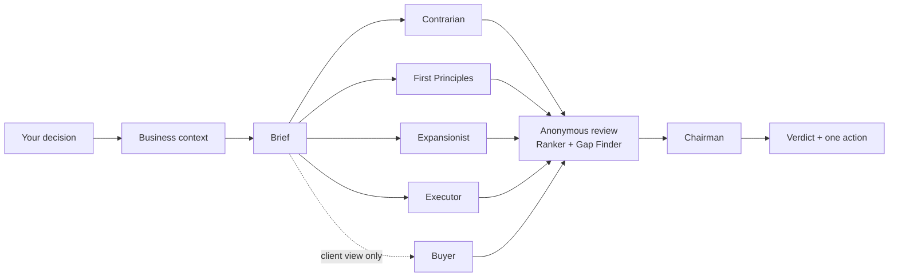

# Prism

**One decision, five angles, one verdict.**

A decision council for one-person businesses: freelancers, consultants, coaches, trainers, solo creators.

When you run a business alone, nobody pushes back on your decisions. Prism gives you that push-back. It reads your business context, splits your decision into five angles (risk, root cause, upside, execution, and how a client sees it), has the answers reviewed anonymously, then gives you one verdict and one action for the next 48 hours. When the evidence isn't there, it says "not yet" and tells you the cheapest way to find out.

> [!IMPORTANT]
> Prism is only as good as the context you give it. Without your offers, prices, clients and capacity, it gives generic advice. Start from the [context template](plugins/prism/skills/prism-council/context-template.md) and the [filled example](examples/context-example.md).

## Prism is for decisions

Prism answers "which one?", not "what else?".

**Good Prism questions**
- "I charge €650 a day. Should I go to €750 for new clients only, or for everyone in January?"
- "Should my flagship offer be a 2-day workshop or a 3-month coaching program?"
- "One client is 60% of my revenue and wants more days. Take them, or keep room for others?"
- "I have 5 hours a week for marketing. LinkedIn content or direct outreach?"

**Not for Prism**
- "What am I missing in my business?" (Prism asks you to name 2 or 3 options first)
- Writing, editing or reviewing copy
- Factual questions
- Decisions inside a company with a team

More in [docs/examples.md](docs/examples.md).

## How it works



1. **Bring a decision.** A real choice with options.
2. **Prism reads your context.** If something's missing, it asks before running.
3. **Five advisors answer separately.** Each from one angle, none sees the others.
4. **Two reviewers judge anonymously.** One ranks the answers, one hunts for what everyone missed.
5. **The chairman decides.** A verdict, a top 3, or "not yet" with the cheapest test to run.
6. **You act within 48 hours.** Then the outcome goes back into your context.

Every answer ends with a way to see the full reasoning: ask "show the council".

Details and all paths in [docs/how-it-works.md](docs/how-it-works.md).

## The council

- **The Contrarian:** "How does this fail?"
- **First Principles:** "What are you actually trying to achieve?"
- **The Expansionist:** "What if this works better than planned?"
- **The Executor:** "What happens Monday morning, and what gets dropped?"
- **The Buyer:** "Would I pay for this? What would I do instead?" Sees only what a client would see.
- **The Ranker** and **the Gap Finder** review anonymously.
- **The Chairman** decides.

## Install

**Claude app (web, desktop, mobile)**
1. Download `prism-council.zip` from the latest [release](../../releases).
2. In Claude: Customize > Skills > "+" > Create skill > Upload a skill.
3. Make sure code execution is enabled.

**Claude Code**
```bash
claude plugin marketplace add <owner>/prism-council
claude plugin install prism@prism
```

**Other platforms:** see [docs/platforms.md](docs/platforms.md).

## Use it

Say "prism this" or "run it through Prism", followed by your decision.

Options, in plain words:
- "give me the top 3" for ranked alternatives
- "detailed" for agreement, clashes and what the review caught

## Models

Use the best model in your app's model picker, with extended thinking on.

Tested with (October 2026):
- Claude Opus 5.5

A full run uses 8 agents. On entry-level plans, it can use a noticeable share of your usage window.

## Credits

Method: [Andrej Karpathy's LLM Council](https://github.com/karpathy/llm-council). Inspired by Ole Lehmann's llm-council skill. Built by [Virgile Gouala](https://goua.la).
