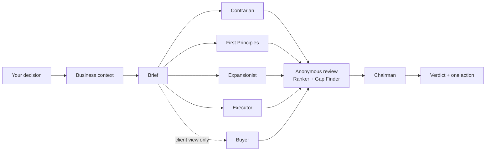
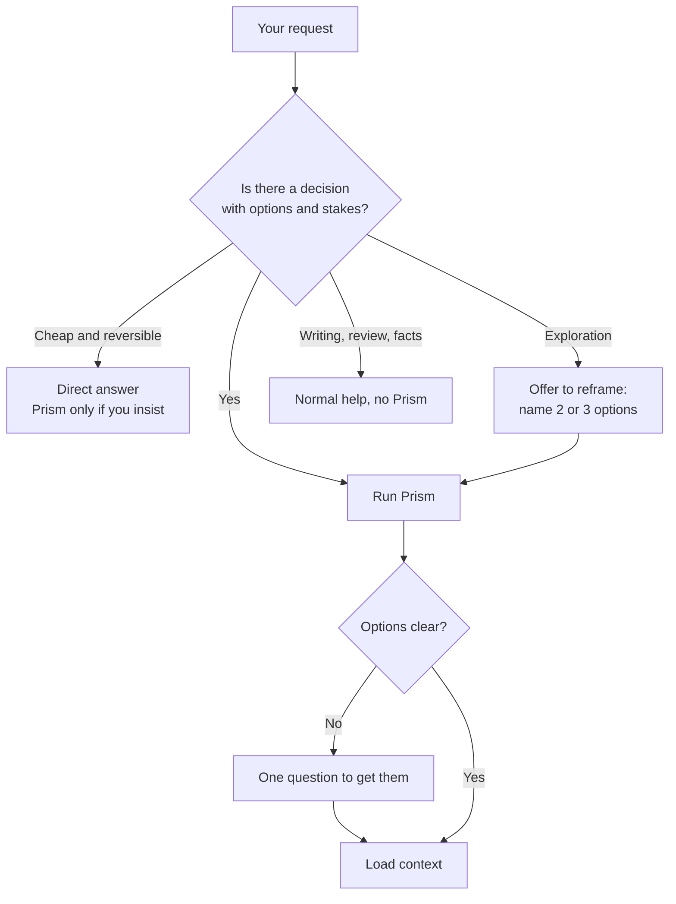
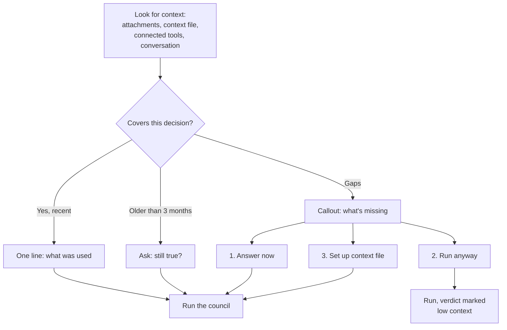
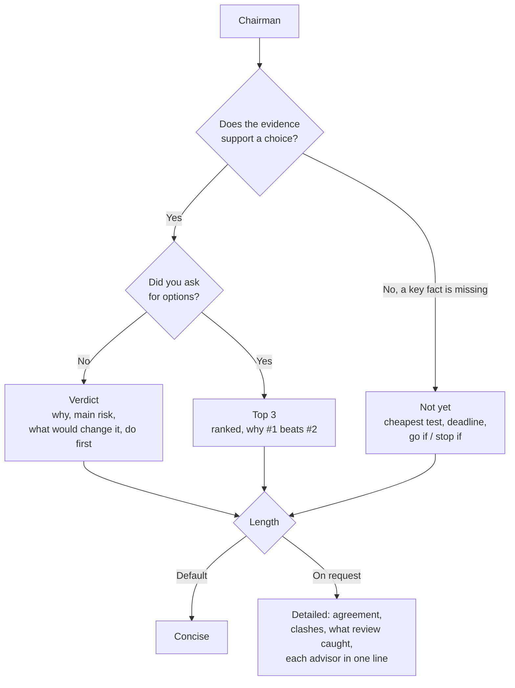
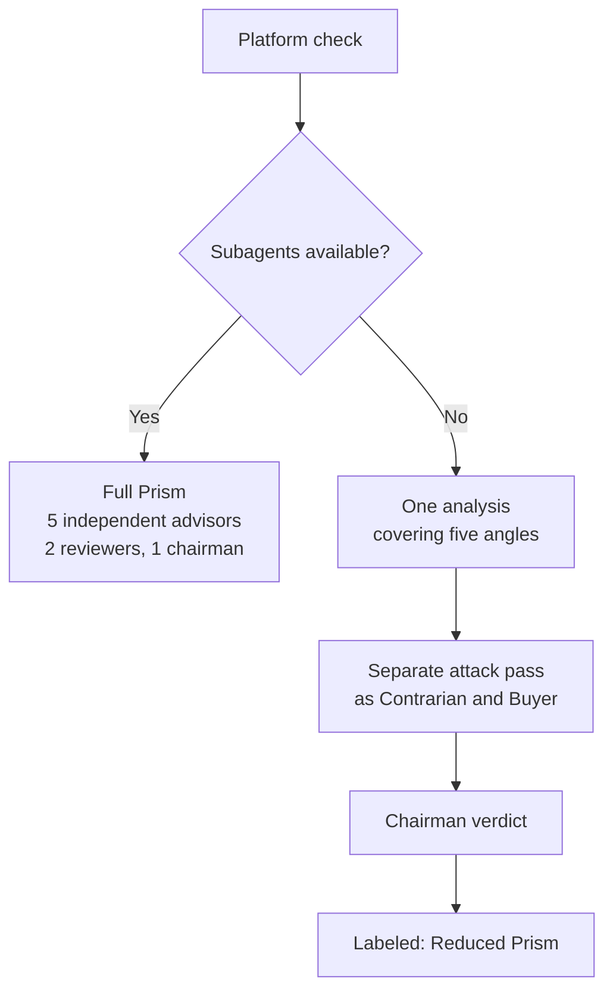
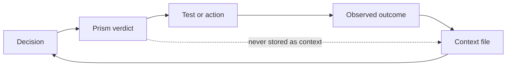

# How Prism works

All diagrams in Mermaid. GitHub renders them directly in README files.

## 1. Overview: the full run

## 2. The gate: is this a Prism question?

## 3. Context check

## 4. The three outcomes

## 5. Full mode vs reduced mode

## 6. The learning loop

