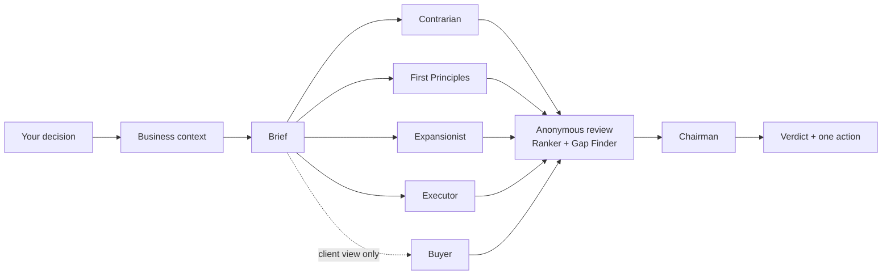
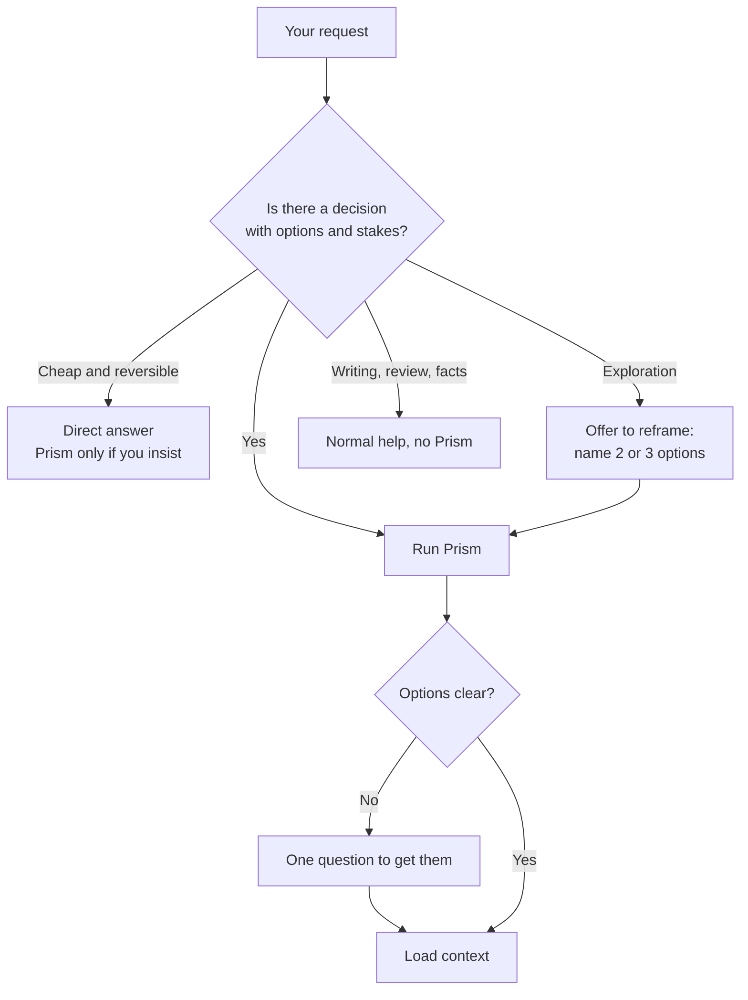
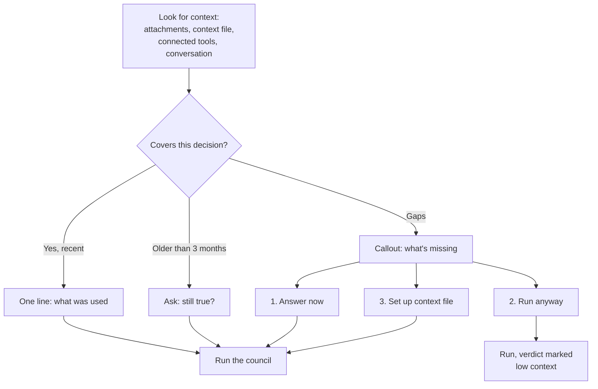
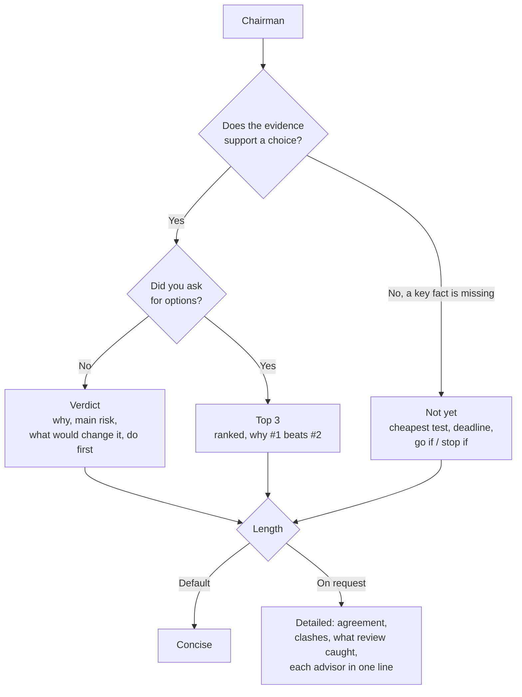
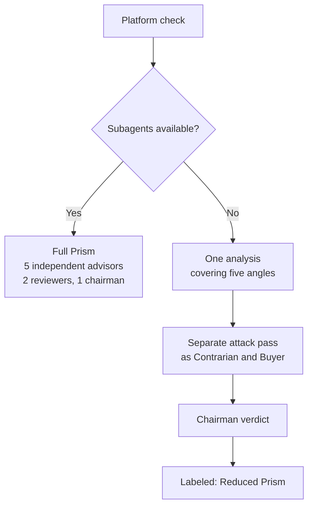
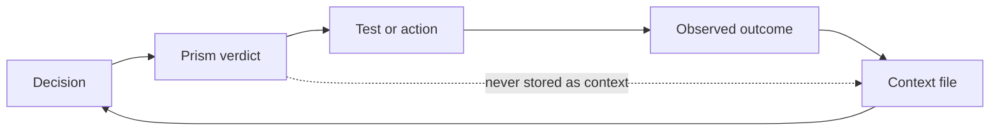

# Prism identity brief

Everything needed to design Prism's logo, visuals and diagrams. Source of truth: `SKILL.md` v0.1.

## 1. Name and taglines

- **Name:** Prism
- **Slug:** `prismatize`
- **Tagline (skill, directories, repo):** One decision, five angles, one verdict.
- **Tagline (landing page):** The advisory board for businesses of one.
- **Trigger phrases:** "prismatize this", "prism this", "run it through Prism", "prismatiser" (French)
- **Claude Code command:** `/prism:prismatize`
- **French hook:** "Voir sa décision à travers le prisme de cinq conseillers."

## 2. Descriptions

**One line (directories, GitHub "About", social bio)**
A decision council for one-person businesses: five AI advisors, an anonymous review, one verdict.

**Short (around 40 words, store listings, cards)**
Prism runs a business decision through five advisors who think independently, two reviewers who judge their work anonymously, and a chairman who delivers a verdict. Built for freelancers, consultants and solo creators who decide alone.

**Medium (README intro, landing page hero)**
When you run a business alone, nobody pushes back on your decisions. Prism gives you that push-back. It reads your business context, splits your decision into five angles (risk, root cause, upside, execution, and how a client sees it), has the answers reviewed anonymously, then gives you one verdict and one action for the next 48 hours. When the evidence isn't there, it says "not yet" and tells you the cheapest way to find out.

**What Prism is**
- A decision tool: options exist and a wrong choice costs time, money or clients
- Built for one-person businesses
- Grounded in your own context (offers, prices, clients, capacity)
- Honest about uncertainty: "not yet" is a valid verdict

**What Prism is not**
- A brainstorming or exploration tool
- A writer, editor or copy reviewer
- A tool for companies with teams and stakeholders
- A replacement for talking to real clients: the Buyer is simulated

## 3. The cast

### The five advisors

Each advisor is one ray of the split light. Pairs create tension: Contrarian vs Expansionist (downside vs upside), First Principles vs Executor (rethink vs do), and the Buyer as the outside view.

- **The Contrarian**
  - Role: finds the flaw before reality does
  - Asks: "How does this fail?"
  - Sees: ignored risks, optimistic assumptions

- **First Principles**
  - Role: checks that you're solving the right problem
  - Asks: "What are you actually trying to achieve?"
  - Sees: the wrong question behind the question
  - Naming note: the only advisor without a "The ...-er" form. If you want a consistent set for visuals, "The Questioner" works.

- **The Expansionist**
  - Role: looks for the upside nobody priced in
  - Asks: "What if this works better than planned?"
  - Sees: hidden opportunities, undervalued options

- **The Executor**
  - Role: tests whether one person can actually do it
  - Asks: "What happens Monday morning, and what gets dropped?"
  - Sees: hours, cash, capacity, first steps

- **The Buyer**
  - Role: a prospect who only sees what a client would see
  - Asks: "Would I pay for this? What would I do instead?"
  - Sees: hesitation, alternatives (DIY, free resources, AI tools, a competitor, doing nothing)
  - Particularity: the only advisor who never sees your internal numbers

### The two reviewers

- **The Ranker:** evaluates the five answers anonymously and ranks them on three criteria: grounded in your situation, names what matters, leads to action.
- **The Gap Finder:** looks for what all five missed: the shared unchecked assumption, the missing topic, the one claim that would flip the decision.

### The chairman

- **The Chairman:** reads everything and decides. Weights facts over assumptions, can side with a minority, checks solo-business risks (cash runway, non-billable hours, client dependence, solo capacity, reversibility).

### Key numbers

- 5 advisors, 2 reviewers, 1 chairman: 8 agents per full run
- 3 possible outcomes: Verdict, Top 3, Not yet
- 2 output lengths: concise (default), detailed
- 1 action at the end, doable within 48 hours

## 4. Visual concept

**The metaphor.** One beam of light enters a prism and splits into colors. Newton showed the split light can be recombined into a single beam. That's Prism exactly: one decision goes in, splits into five angles, and recombines into one verdict. The visual story is **in, split, recombine**, not only "split".

**Link with goua.la.** The goua.la logo already uses a triangle among its geometric shapes. Prism's triangle can be that same triangle, making Prism read as a goua.la product without extra explanation.

**Logo directions**
- **A. Split and recombine:** a triangle, one white line entering on the left, five colored lines leaving on the right and converging back to a single point. Tells the whole story. Best for the hero and README header.
- **B. Triangle only:** a plain triangle with five thin colored lines inside. Works at favicon size (16 to 32 px), where direction A becomes unreadable.
- **C. Wordmark:** "prism" in DM Sans, lowercase like goua.la, with the triangle replacing the dot or sitting before the word.

Use A for large formats, B for icons and avatars, C for headers.

**Color mapping**
The goua.la palette has four accents (teal, coral, purple, orange). Prism needs five advisor colors plus a verdict color. Suggested mapping, adding one yellow:

- The Contrarian: coral (warning, risk)
- The Expansionist: orange (energy, upside)
- The Executor: teal (go, action)
- First Principles: purple (depth)
- The Buyer: yellow (the outside light, a new color for the outside view)
- Chairman / verdict: white beam on the #191919 background
- Reviewers: grey (they judge, they don't add a color)
- Low-context verdict: dimmed or dashed white beam

Keep illustrations black and white like the rest of goua.la. Color appears only on the five rays and in diagrams.

**Typography and background**
- DM Sans, as goua.la
- Dark background #191919 by default

## 5. Diagrams

All diagrams in Mermaid. GitHub renders them directly in README files.

### 5.1 Overview: the full run

### 5.2 The gate: is this a Prism question?

### 5.3 Context check

### 5.4 The three outcomes

### 5.5 Full mode vs reduced mode

### 5.6 The learning loop

## 6. Copy for the "how it works" section

1. **Bring a decision.** A real choice with options, not an open question.
2. **Prism reads your context.** Offers, prices, clients, capacity. If something's missing, it asks before running.
3. **Five advisors answer separately.** Each from one angle, none sees the others.
4. **Two reviewers judge anonymously.** One ranks the answers, one hunts for what everyone missed.
5. **The chairman decides.** A verdict, a top 3, or "not yet" with the cheapest test to run.
6. **You act within 48 hours.** One action, then the outcome goes back into your context.

## 7. Credits

Method: Andrej Karpathy's LLM Council. Inspired by Ole Lehmann's llm-council skill. Built by Virgile Gouala (goua.la).
